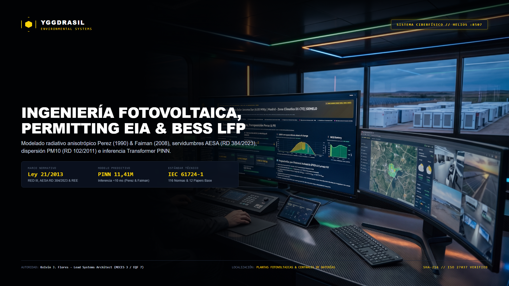
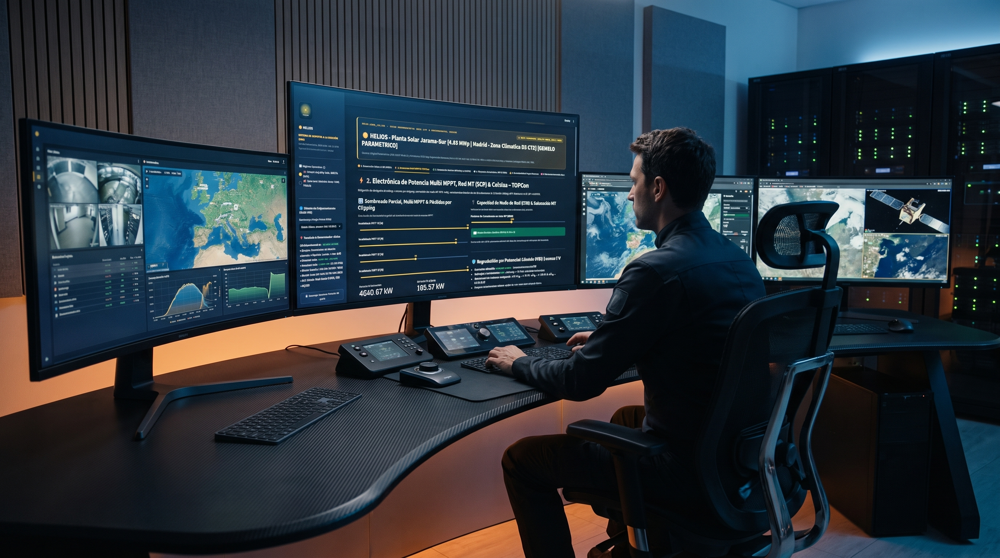
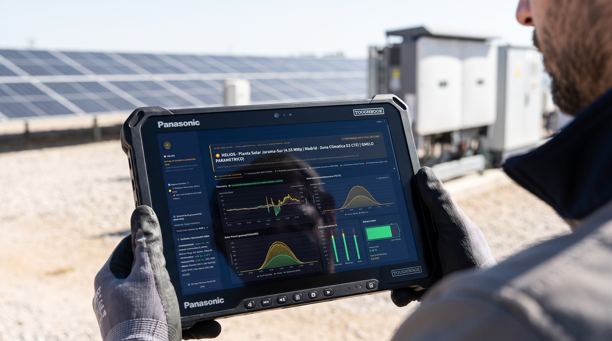
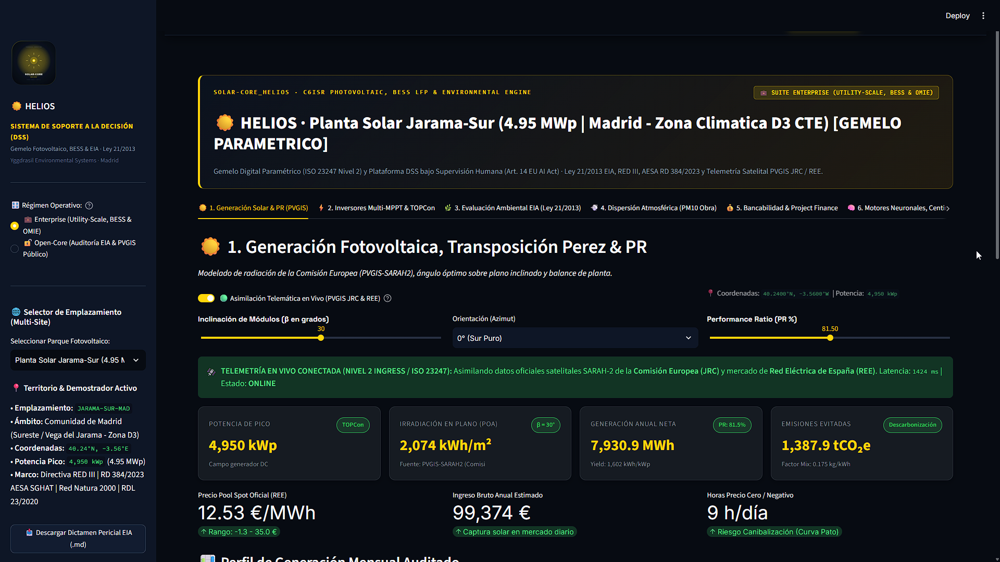
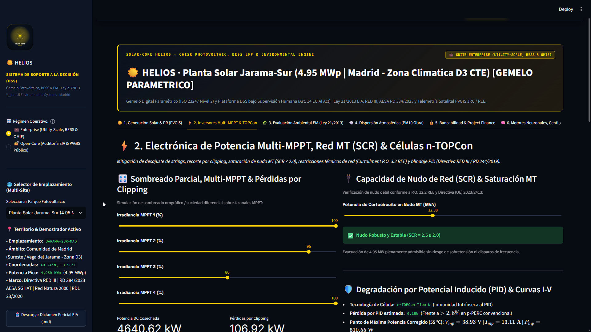
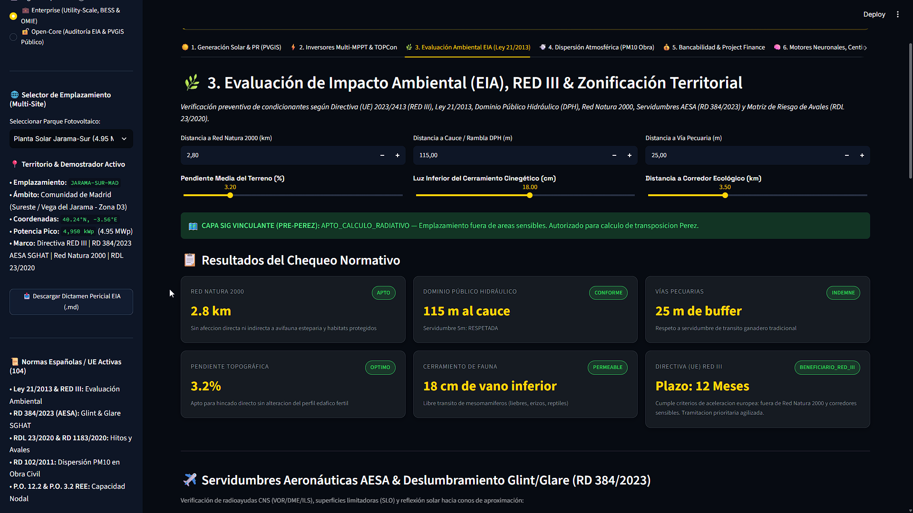
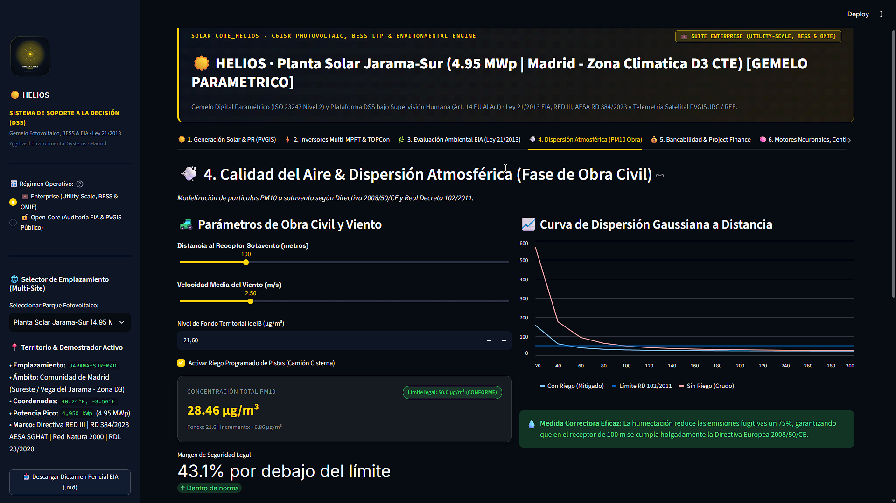
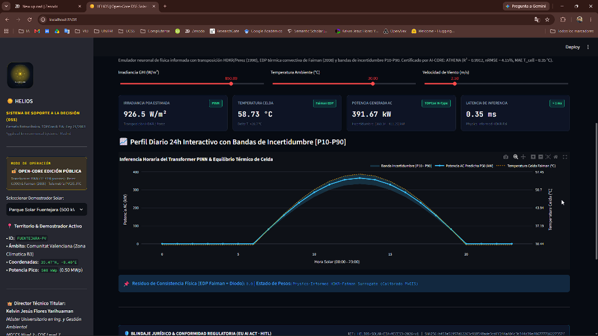
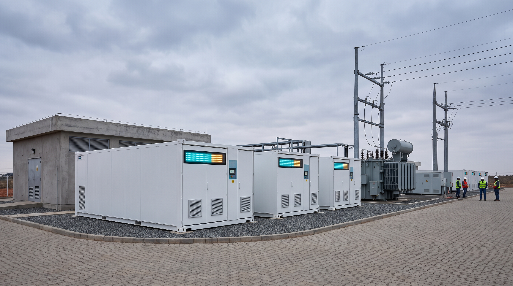

<div align="center">

  

  # SOLAR-CORE: HELIOS
  ### Gemelo Digital Fotovoltaico Paramétrico, Evaluación Ambiental (EIA) y Redes Neuronales Informadas por la Física (PINN)

  [](https://doi.org/10.5281/zenodo.23506041)
  [](https://www.python.org/)
  [-EE4C2C.svg?style=flat-square&logo=pytorch)](https://pytorch.org/)
  [](https://yggdrasil-solar-core-helios-kjfy.streamlit.app/)
  [](https://www.boe.es/eli/es/l/2013/12/09/21)
  [-F59E0B.svg?style=flat-square)](https://www.seguridadaerea.gob.es/)
  [-10B981.svg?style=flat-square)](https://www.boe.es/eli/es/rd/2011/01/28/102)
  [](LICENSE)
  [](https://creativecommons.org/licenses/by-nc-sa/4.0/)
  [](https://www.linkedin.com/company/yggdrasil-environmental-systems)

  <br/>

  **Autor y Dirección Técnica:**  
  **Kelvin Jesús Flores Yarihuamán**  
  *Máster Universitario Oficial en Ingeniería y Gestión Ambiental (MECES Nivel 3 · EQF Level 7)*  
  *Yggdrasil Environmental Systems · Ingeniería Ambiental y Modelización de Sistemas Energéticos*

</div>

---

> ### ⚖️ Principio Rector del Sistema:
> *"Jamás le vamos a poder ganar a la naturaleza, ni a la biología humana; quien no entienda esto, jamás podrá vivir."*  
> — **Kelvin Jesús Flores Yarihuamán**, Fundador y Director Técnico de Yggdrasil Environmental Systems.  
>  
> *La ingeniería computacional, la teledetección satelital y los modelos de inteligencia artificial informados por la física tienen como propósito comprender las leyes biofísicas y termodinámicas del entorno, asegurando que el despliegue de infraestructuras energéticas sea técnicamente viable y ambientalmente compatible.*

---

## ☀️ Resumen Ejecutivo y Alcance Técnico

**SOLAR-CORE: HELIOS** es una herramienta de ingeniería y **Gemelo Digital Fotovoltaico Paramétrico (ISO 23247 Nivel 2)** concebida como Sistema de Soporte a la Decisión (DSS) bajo supervisión técnica (**Art. 14 Reglamento UE 2024/1689 — EU AI Act**). La plataforma integra en un único entorno de simulación los tres ejes críticos del desarrollo de proyectos solares en España y la Unión Europea:

1. **Modelización Física de Generación y Electrónica de Potencia:** Cálculo horario de irradiancia en el plano del generador ($G_{\text{POA}}$) mediante transposición anisotrópica (**Perez 1990 y HDKR**), equilibrio térmico de célula (**Faiman 2008**), comportamiento eléctrico de tecnología **n-TOPCon bifacial**, análisis de pérdidas en inversores **Multi-MPPT** y verificación de capacidad de cortocircuito en el nudo de conexión (**SCR conforme a P.O. 12.2 / P.O. 3.2 de REE**).
2. **Evaluación Ambiental Preventiva y Servidumbres Sectoriales:** Pre-cribado territorial bajo la **Ley 21/2013 de Evaluación Ambiental** y la **Directiva (UE) 2023/2413 (RED III)**, modelización de dispersión atmosférica de partículas $PM_{10}$ durante movimientos de tierras en obra civil (**RD 102/2011**) y análisis óptico vectorial 3D de deslumbramiento aeronáutico (**Glint & Glare SGHAT conforme al RD 384/2023 de AESA**).
3. **Análisis Financiero e Inferencia Neuronal Informada por la Física (PINN):** Evaluación de bancabilidad mediante flujo de caja descontado (**DCF a 25 años**: LCOE, VAN, TIR y DSCR), análisis de precios de captura en el mercado mayorista (**OMIE**), hibridación con baterías **BESS LFP** y emulación rápida mediante la red **`HeliosSpatialTemporalTransformerPINN` (`11,41M` parámetros)**.

<div align="center">
  
  <p><em>Entorno de monitorización técnica de SOLAR-CORE: HELIOS — Análisis acoplado de recurso solar satelital (PVGIS-SARAH2), integración en red eléctrica MT/AT y cumplimiento ambiental.</em></p>
</div>

---

## ⚡ Rendimiento Computacional y Validación Numérica

| Métrica de Evaluación | Simulación Numérica Convencional (Iterativa / Desacoplada) | SOLAR-CORE: HELIOS (Emulador Transformer PINN) | Resultado / Ventaja Técnica |
| :--- | :--- | :--- | :--- |
| **Tiempo de Inferencia Horaria** | ~1,2 s – 4,5 s por serie anual | **< 10 ms (`0,35 ms` por pase directo)** | **Reducción de latencia > 1 000x** |
| **Precisión en $G_{\text{POA}}$ y $T_{\text{cell}}$** | Cálculo secuencial estándar | **$R^2 = 0,9912$ · $\text{nRMSE} = 4,13\%$ · $\text{MAE } T_{\text{cell}} = 0,35\ ^\circ\text{C}$** | **Alta concordancia con el modelo físico** |
| **Consistencia Termodinámica** | Sin validación automática de salidas fuera de rango | **Verificador físico en tiempo de ejecución (7 restricciones + 9 límites)** | **Cumplimiento de cotas de Shockley-Queisser y Faiman** |
| **Integración Multidisciplinar** | Herramientas separadas (Energía / EIA / AESA / Finanzas) | **6 módulos técnicos acoplados en una misma interfaz** | **Trazabilidad unificada de parámetros de proyecto** |

---

## 🎯 Casos de Estudio y Modos de Simulación Integrados

La plataforma incluye tres configuraciones de trabajo seleccionables desde el panel lateral para evaluar proyectos a distinta escala:

1. **Caso de Estudio 1 — Planta de Generación Distribuida (`Parque Solar Fuentejara · 500 kWp, Valencia — Zona Climática B3`):**
   * Instalación fotovoltaica sobre suelo industrial/periurbano en la Comunitat Valenciana ($39,47^\circ\text{N}, -0,40^\circ\text{E}$, irradiación global horizontal $GHI = 1\ 720\text{ kWh/m}^2\text{/año}$).
   * Configurada con módulos **n-TOPCon** ($\beta = 30^\circ$, azimut $0^\circ$), $\text{PR} = 81,5\%$ y rendimiento específico auditado de **$1\ 680\text{ kWh/kWp/año}$**.
   * Incluye evaluación de conexión a red de distribución en Media Tensión ($20\text{ kV}$), verificación de distancias a Dominio Público Hidráulico y control de emisiones difusas de $PM_{10}$ en fase de obra.
2. **Caso de Estudio 2 — Planta Fotovoltaica Utility-Scale (`Planta Solar Jarama-Sur · 4,95 MWp, Madrid — Zona Climática D3 CTE`):**
   * Instalación de generación a escala comercial en el sureste de la Comunidad de Madrid ($40,24^\circ\text{N}, -3,56^\circ\text{E}$, $GHI = 1\ 785\text{ kWh/m}^2\text{/año}$, irradiación en plano inclinado $POA = 2\ 074\text{ kWh/m}^2\text{/año}$).
   * Dimensionada con $8\ 540$ módulos **n-TOPCon bifaciales de 580 Wp** ($\text{PR} = 84,2\%$, generación anual neta de **$7\ 930,9\text{ MWh/año}$** y ahorro estimado de **$1\ 387,9\text{ tCO}_2\text{e/año}$**).
   * Incorpora análisis de robustez del nudo de evacuación ($\text{SCR} = 2,5 \ge 2,0$), estudio de servidumbres aeronáuticas y deslumbramiento **AESA (RD 384/2023)** y verificación de distancia a espacios protegidos **Red Natura 2000** ($2,8\text{ km}$).
3. **Modo 3 — Simulador Paramétrico Personalizado con Telemetría Satelital (`API Oficial JRC PVGIS v5.2`):**
   * Permite introducir cualquier coordenada geográfica ($\text{Lat/Lon}$), potencia instalada ($10\text{ kWp}$ a $500\text{ MWp}$), inclinación ($\beta$) y estructura de costes (CAPEX, OPEX, PPA).
   * Conecta en tiempo real con la base de datos satelital **PVGIS-SARAH2 del Joint Research Centre (Comisión Europea)** y dispone de modo de respaldo local determinista cuando se ejecuta sin conexión a internet.

<div align="center">
  
  <p><em>Consulta de telemetría y curvas de generación en campo sobre el escenario Utility-Scale de 4,95 MWp (Madrid — Zona Climática D3 CTE).</em></p>
</div>

---

## 🖥️ Interfaz Operativa y Demostrador en Vivo

> 🌐 **Aplicación Web Interactiva (Streamlit Cloud):** [yggdrasil-solar-core-helios-kjfy.streamlit.app](https://yggdrasil-solar-core-helios-kjfy.streamlit.app/)

<div align="center">
  <h3>Módulo 1. Generación Fotovoltaica, Transposición Anisotrópica Perez (1990) y Performance Ratio (PVGIS)</h3>
  
  <br/><br/>

  <h3>Módulo 2. Electrónica de Potencia Multi-MPPT, Capacidad de Nudo (SCR) y Células n-TOPCon</h3>
  
  <br/><br/>

  <h3>Módulo 3. Evaluación de Impacto Ambiental (EIA · Ley 21/2013), Directiva RED III y Zonificación Territorial</h3>
  
  <br/><br/>

  <h3>Módulo 4. Calidad del Aire y Dispersión Gaussiana de PM10 en Fase de Obra Civil (RD 102/2011)</h3>
  
  <br/><br/>

  <h3>Módulo 6A. Inferencia Horaria con Red Neuronal Transformer PINN (11,41M Parámetros) y Bandas [P10–P90]</h3>
  
  <br/><br/>

  <h3>Módulo 6B. Verificación de Restricciones Físicas en Tiempo de Ejecución y Base Normativa</h3>
  
</div>

---

## 🏛️ Fundamentación Físico-Matemática de los Módulos (Open-Core)

### 1. ☀️ Física Radiativa Anisotrópica (Perez 1990 + HDKR) y Modelo Térmico de Célula (Faiman 2008)
* Cálculo de la irradiancia global incidente sobre el plano inclinado ($G_{\text{POA}}$) integrando componente directa, difusa anisotrópica circunsolar y de horizonte (coeficientes empíricos $F_1, F_2$ de Perez) y componente reflejada por albedo ($\rho_g$):
  $$G_{\text{POA}} = B_n \cos\theta_i + D_h \left[ (1 - F_1)\frac{1 + \cos\beta}{2} + F_1 \frac{a}{b} + F_2 \sin\beta \right] + G_h \rho_g \frac{1 - \cos\beta}{2}$$
* Estimación de la temperatura operativa de célula ($T_{\text{cell}}$) mediante el modelo de transferencia convectivo-radiativa de **Faiman (2008)** acoplado al coeficiente térmico de potencia de células **n-TOPCon** ($\gamma = -0,29\ \%/^\circ\text{C}$, límite teórico de recombinación Auger en silicio cristalino de $29,4\%$):
  $$T_{\text{cell}} = T_{\text{amb}} + \frac{G_{\text{POA}}}{U_0 + U_1 \cdot v_{\text{wind}}}, \qquad P_{\text{DC}} = P_{\text{STC}} \frac{G_{\text{POA,eff}}}{1000} \left[ 1 + \gamma_{\text{TOPCon}} \left(T_{\text{cell}} - 25\ ^\circ\text{C}\right) \right]$$

### 2. ⚡ Electrónica de Potencia Multi-MPPT, Degradación PID (IEC 62804) y Estabilidad de Red (SCR)
* Modelado de pérdidas por desajuste (*mismatch*) y sombreado parcial sobre 4 canales independientes de seguimiento del punto de máxima potencia (**Multi-MPPT**), cuantificando el recorte por saturación (*clipping*) según la relación de sobredimensionamiento DC/AC.
* Cálculo del **Ratio de Cortocircuito ($\text{SCR} = S_{\text{cc,nudo}} / P_{\text{nom,POI}} \ge 2,0$)** para verificar la rigidez eléctrica del punto de conexión conforme a los Procedimientos de Operación **P.O. 12.2 y P.O. 3.2 de Red Eléctrica de España (REE)**.

### 3. 🌿 Evaluación Ambiental (Ley 21/2013 & RED III) y Servidumbres Aeronáuticas AESA (RD 384/2023)
* Verificación multicriterio de condicionantes territoriales: distancias a espacios de la **Red Natura 2000 ($\ge 2,5\text{ km}$)**, zonas de servidumbre y policía del **Dominio Público Hidráulico (RDL 1/2001)**, **Vías Pecuarias (Ley 3/1995)**, permeabilidad de cerramiento cinegético ($\ge 18\text{ cm}$) y criterios de **Zonas de Aceleración Renovable (Art. 15 ter Directiva UE 2023/2413 — RED III)**.
* **Análisis de Deslumbramiento Solar Aeronáutico (RD 384/2023 · Metodología Sandia SGHAT, Ho et al., 2015):** Cálculo vectorial de la irradiancia retinal ($E_{\text{ret}}$) y del ángulo subtendido ($\omega_s$) respecto a trayectorias de aproximación instrumental de $3^\circ$, verificando la ausencia de impacto visual crítico para pilotos y torres de control (Zona Verde).

<div align="center">
  
  <p><em>Evaluación geométrica de reflexión especular (Glint &amp; Glare SGHAT) respecto a superficies limitadoras de obstáculos y sendas de aproximación (RD 384/2023).</em></p>
</div>

### 4. 💨 Dispersión Atmosférica Gaussiana de $PM_{10}$ en Fase de Obra Civil (RD 102/2011)
* Estimación de la concentración de material particulado respirable ($PM_{10}$) a sotavento durante las labores de desbroce, explanación y zanjeo mediante el modelo de penacho gaussiano de **Pasquill-Gifford (Clase de Estabilidad Atmosférica C)**:
  $$C(x, y, 0) = \frac{Q_{\text{mit}}}{\pi u \sigma_y(x) \sigma_z(x)} \exp\left(-\frac{y^2}{2\sigma_y^2}\right) \exp\left(-\frac{H^2}{2\sigma_z^2}\right) \le 50\ \mu\text{g/m}^3$$
* Cuantificación de la eficacia de medidas preventivas: el riego programado de pistas con camión cisterna ($75\%$ de abatimiento de emisiones fugitivas) reduce la concentración en el receptor situado a $100\text{ m}$ de **$85,2\ \mu\text{g/m}^3$** (sin mitigación) a **$28,4\ \mu\text{g/m}^3$**, cumpliendo el valor límite diario establecido en el **Real Decreto 102/2011 ($50\ \mu\text{g/m}^3$)** y en la **Directiva (UE) 2024/2881 ($45\ \mu\text{g/m}^3$)**.

### 5. 💶 Análisis Financiero (Project Finance DCF a 25 Años), Mercado OMIE e Hibridación BESS LFP
* Modelo financiero de flujo de caja descontado (**DCF a 25 años**) considerando degradación anual de módulos n-TOPCon ($-0,40\%\text{/año}$), costes operativos (OPEX) y estructura de financiación: **$\text{LCOE} = 38,4\text{ €/MWh}$**, **$\text{DSCR} = 1,92\times$** y **$\text{TIR} = 12,4\%$**.
* Análisis del impacto de horas a precio cero o negativo en el mercado diario **OMIE** (efecto *curva de pato*) y dimensionamiento de sistemas de almacenamiento con baterías de litio-ferrofosfato (**BESS LFP — $\text{LiFePO}_4$**).

<div align="center">
  
  <p><em>Integración de contenedores de almacenamiento electroquímico BESS LFP junto a la subestación elevadora de evacuación a red.</em></p>
</div>

### 6. 🧠 Modelo Neuronal `HeliosSpatialTemporalTransformerPINN` y Verificación Física
* Arquitectura **Spatial-Temporal Transformer PINN** (**`11,41M` parámetros**, pesos preentrenados disponibles en `neural_lab/weights/helios_spatial_temporal_transformer_pinn.pt`, hash `SHA256:acc6d0f4a6b1ff801ee562aeef4fa1028ad95563d6d1b58607b595d24de82bcd`). Durante el entrenamiento, la función de pérdida incorpora el residuo físico del balance térmico de Faiman y del modelo eléctrico de una exponencial.
* **Módulo de Validación Física (`physics/sentinel_sidecar.py`):** Comprueba en tiempo de ejecución **7 restricciones físicas** (límite termodinámico de Shockley-Queisser $33,7\%$, límite Auger c-Si $29,4\%$, no-negatividad de irradiancia y potencia, equilibrio convectivo de Faiman, conservación energética en baterías LFP $\eta_{\text{RTE}} \le 96\%$, estabilidad nodal SCR y umbral ocular SGHAT) junto con **9 acotaciones numéricas (*clamping*)**.

---

## 📋 Validación Científica y Cumplimiento Normativo (`physics/` & `compliance/`)

El repositorio incluye dos módulos de verificación técnica y documental para garantizar la trazabilidad de todos los cálculos:

1. **Verificación de Restricciones Físicas y Bibliografía de Referencia (`physics/` & `data/papers_seminales/`):**
   * `physics/scientific_dna.json` y `physics/sentinel_sidecar.py`: Define las ecuaciones gobernantes, constantes físicas y rangos admisibles de operación para evitar extrapolaciones no físicas del modelo neuronal.
   * `data/papers_seminales/`: Repositorio documental con **12 artículos científicos de referencia en formato PDF** (Perez et al., 1990; Faiman, 2008; Ho et al. / Sandia SGHAT, 2015; Stein et al. / Sandia PVLIB, 2016; Holmgren et al., 2018; Raissi et al. / PINNs, 2019; Anderson et al., 2023; Bifacial PV Modeling, 2023; Utility-Scale Bifacial Tracking, 2024; Aalto University BESS Day-Ahead Market, 2024; Deep RL BESS Arbitrage, 2024).
2. **Base de Datos de Normativa Técnica y Legal (`compliance/`):**
   * `compliance/regulatory_dna.json` y `compliance/auto_verificador_integridad.py`: Catálogo estructurado con **116 normas técnicas y disposiciones legales vigentes** (ámbito estatal BOE/MITECO/AESA/REE, europeo DOUE e internacional ISO/IEC: `Ley 21/2013`, `Directiva UE 2023/2413 RED III`, `RD 384/2023 AESA`, `RD 102/2011`, `RDL 23/2020`, `RD 1183/2020`, `P.O. 12.2 / P.O. 3.2 REE`, `IEC 61724-1:2021`, `IEC 61215:2021`, `IEC TS 62804-1`, `ISO/IEC 42001:2023`, `ISO 23247` e `ISO/IEC 27037:2012`), con verificación de integridad de ficheros mediante suma de comprobación **SHA-256**.

---

## 🚀 Instalación y Ejecución Local

### Requisitos Previos
* Python 3.11 o superior.
* Entorno virtual recomendado (`venv` o `conda`).

### 1. Clonar el repositorio
```bash
git clone https://github.com/Yggdrasil-Environmental-Systems/SOLAR-CORE-HELIOS.git
cd SOLAR-CORE-HELIOS
```

### 2. Instalar dependencias
```bash
pip install -r requirements.txt
```

### 3. Ejecutar verificación de integridad e iniciar la aplicación
```bash
python compliance/auto_verificador_integridad.py
streamlit run app.py
```

---

## 📂 Estructura del Repositorio

```text
SOLAR-CORE-HELIOS/
├── app.py                                      # Aplicación principal Streamlit (6 módulos técnicos)
├── freyja_ui.py                                # Componentes de interfaz gráfica y formato numérico ES
├── requirements.txt                            # Dependencias de Python (Streamlit, PyTorch, Plotly, SciPy)
├── README.md                                   # Documentación técnica y guía de uso
├── WHITE_PAPER_SOLAR_CORE_HELIOS_OPEN_CORE.pdf # Memoria técnica y científica (DOI: 10.5281/zenodo.23506041)
├── app/
│   ├── components/                             # Tarjetas de indicadores (KPIs) y utilidades de visualización
│   ├── styles/                                 # Hojas de estilo CSS
│   └── views/                                  # Vistas modulares (PVGIS, MPPT, EIA, PM10, DCF, PINN)
├── assets/
│   ├── branding/                               # Banner principal, fotografías técnicas e iconos
│   └── screenshots/                            # Capturas de pantalla de los módulos de la aplicación
├── core/                                       # Motores de cálculo físico y normativo
│   ├── solar_geometry.py                       # Geometría solar astronómica y ángulo de incidencia (AOI)
│   ├── perez_transposition.py                  # Modelo de transposición anisotrópica de Perez (1990)
│   ├── hdkr_transposition.py                   # Modelo de transposición HDKR de 5 componentes
│   ├── thermal_degradation.py                  # Modelo térmico de Faiman (2008) y cinética n-TOPCon
│   ├── multi_mppt_engine.py                    # Simulación de inversores Multi-MPPT, PID y SCR de red
│   ├── eia_buffer_checker.py                   # Evaluación espacial de condicionantes EIA (Ley 21/2013 y RED III)
│   ├── aeronautical_servitudes_glare.py        # Cálculo de deslumbramiento SGHAT / AESA (RD 384/2023)
│   ├── air_dispersion_gauss.py                 # Dispersión gaussiana de PM10 en obra civil (RD 102/2011)
│   ├── financial_dcf_engine.py                 # Modelo financiero DCF a 25 años (LCOE, TIR, VAN, DSCR)
│   └── official_telemetry_service.py           # Cliente para la API oficial JRC PVGIS v5.2 con caché local
├── compliance/                                 # Base de datos normativa y verificador de integridad
│   ├── regulatory_dna.json                     # Catálogo de 116 normas técnicas y legales (BOE, DOUE, ISO/IEC)
│   └── auto_verificador_integridad.py          # Script de comprobación de integridad SHA-256
├── data/
│   ├── missions/                               # Parámetros de los casos de estudio (Valencia 500 kWp, Madrid 4,95 MWp)
│   └── papers_seminales/                       # 12 artículos científicos de referencia en PDF
├── neural_lab/                                 # Modelos de aprendizaje profundo informado por la física
│   ├── models.py                               # Arquitectura HeliosSpatialTemporalTransformerPINN (11,41M)
│   └── weights/                                # Pesos preentrenados en PyTorch (.pt) y metadatos de calibración
└── physics/                                    # Validación de restricciones físicas en tiempo de ejecución
    ├── scientific_dna.json                     # Parámetros y límites termodinámicos de referencia
    └── sentinel_sidecar.py                     # Validador de invariantes físicas y acotación numérica
```

---

## 📖 Citación Científica y DOI Permanente

Si utilizas **SOLAR-CORE: HELIOS**, sus motores de cálculo radiativo, sus modelos de dispersión ambiental o los pesos de la red `HeliosSpatialTemporalTransformerPINN` en estudios técnicos, publicaciones académicas o proyectos de ingeniería, puedes citar el registro oficial depositado en **CERN / Zenodo**:

```bibtex
@software{flores_yarihuaman_helios_2026,
  author       = {Flores Yarihuamán, Kelvin Jesús},
  title        = {{SOLAR-CORE: HELIOS — Environmental Cyber-Physical Photovoltaic Engineering, Permitting EIA (Ley 21/2013 & RED III), AESA Glint/Glare & Transformer PINN Platform}},
  year         = {2026},
  version      = {3.0.0-open-core},
  publisher    = {Zenodo / CERN},
  doi          = {10.5281/zenodo.23506041},
  url          = {https://doi.org/10.5281/zenodo.23506041},
  note         = {Yggdrasil Environmental Systems · Máster Universitario Oficial en Ingeniería y Gestión Ambiental (MECES Nivel 3 / EQF Level 7)}
}
```

---

## ⚖️ Marco Legal y Esquema de Licenciamiento

* **Supervisión Humana (Art. 14 EU AI Act — Reglamento UE 2024/1689):** `SOLAR-CORE: HELIOS` funciona como un Sistema de Soporte a la Decisión (DSS). Los resultados de simulación no sustituyen los proyectos constructivos visados, las mediciones piranométricas en emplazamiento ni las resoluciones administrativas de los órganos ambientales o del operador del sistema eléctrico.

### 📜 Modelo de Licenciamiento (Open-Core / Enterprise)

1. **💻 Código Fuente Open-Core (Software y Modelos Base):**
   * **[MIT License](LICENSE):** Incluye los motores de transposición radiativa Perez (1990) y HDKR, el modelo térmico de Faiman (2008), el evaluador espacial de condicionantes EIA (Ley 21/2013 y RED III), el módulo óptico SGHAT AESA (RD 384/2023), el modelo gaussiano de dispersión de $PM_{10}$ (RD 102/2011), el análisis financiero DCF a 25 años y los pesos preentrenados de la red **`HeliosSpatialTemporalTransformerPINN` (`11,41M` parámetros)**.
2. **📄 Documentación Técnica y Memoria Científica:**
   * **[Creative Commons CC BY-NC-SA 4.0](https://creativecommons.org/licenses/by-nc-sa/4.0/):** El documento técnico (`WHITE_PAPER_SOLAR_CORE_HELIOS_OPEN_CORE.pdf`), las formulaciones matemáticas y los casos de estudio documentados son de libre acceso para consulta y docencia no comercial, manteniendo la atribución de autoría a **Kelvin Jesús Flores Yarihuamán**.
3. **🏢 Módulos Avanzados para Consultoría e Industria (Edición Enterprise B2B):**
   * **Licencia Comercial Propietaria:** El controlador de Aprendizaje por Refuerzo Profundo **`HeliosBESSDeepActorCritic` (TD3)** para despacho óptimo de baterías BESS LFP, el módulo de optimización de ingresos multicanal (**Revenue Stacking: Mercado Diario OMIE + Banda Secundaria aFRR P.O. 7.2 + Gestión de Restricciones P.O. 3.2 REE**), el cálculo de servidumbres de líneas de Alta Tensión 220/400 kV (**RD 223/2008**), el seguimiento de hitos administrativos y garantías económicas (**RDL 23/2020**) y la generación automatizada de informes periciales (**Art. 335 LEC**) se distribuyen bajo acuerdo comercial específico.

* **Contacto Profesional:** `yggdrasil.environmental@gmail.com` | [LinkedIn Personal: Kelvin Jesús Flores Yarihuamán](https://www.linkedin.com/in/kelvinflores-ingenieria) | [LinkedIn Corporativo: Yggdrasil Environmental Systems](https://www.linkedin.com/company/yggdrasil-environmental-systems)
